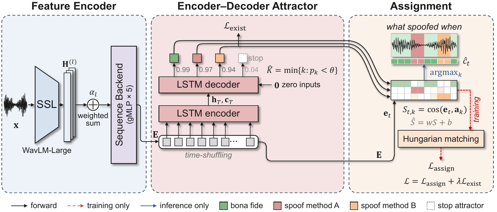

<div align="center">

<h2>[NeurIPS 2026] Clustering-Free End-to-End Spoof Diarization<br>with Encoder-Decoder Attractors</h2>

Bongsu Jung<sup>1</sup> &nbsp;&nbsp; Donghee Kim<sup>2</sup> &nbsp;&nbsp; Wooil Kim<sup>1</sup>

<sup>1</sup>Department of Computer Science and Engineering &nbsp;&nbsp;
<sup>2</sup>Department of Artificial Intelligence<br>
Incheon National University, Republic of Korea


<a href="LICENSE"></a>

</div>

<p align="center"></p>

This repository contains the official PyTorch code of **Clustering-Free End-to-End Spoof
Diarization with Encoder-Decoder Attractors** (NeurIPS 2026).

## Results

The table shows the results on the PartialSpoof evaluation set with the estimated K. Each value
is the mean ± std over three runs (%). Lower is better, except for K-acc.

| Front-end | JI | JER | Known | Varied | Unknown | K-acc |
|---|---|---|---|---|---|---|
| WavLM-Large (default) | 7.77&nbsp;±&nbsp;0.68 | 16.01&nbsp;±&nbsp;0.95 | 9.55&nbsp;±&nbsp;0.42 | 8.70&nbsp;±&nbsp;0.24 | 22.33&nbsp;±&nbsp;1.77 | 88.44&nbsp;±&nbsp;1.65 |
| XLS-R 300M | 10.77&nbsp;±&nbsp;1.74 | 19.60&nbsp;±&nbsp;1.60 | 7.94&nbsp;±&nbsp;0.19 | 10.18&nbsp;±&nbsp;0.70 | 28.69&nbsp;±&nbsp;2.75 | 82.27&nbsp;±&nbsp;2.44 |
| wav2vec 2.0 Large (3C front-end) | 11.56&nbsp;±&nbsp;0.39 | 21.90&nbsp;±&nbsp;0.56 | 12.26&nbsp;±&nbsp;0.68 | 12.77&nbsp;±&nbsp;0.66 | 30.25&nbsp;±&nbsp;0.47 | 84.53&nbsp;±&nbsp;1.20 |

## Installation

```bash
git clone https://github.com/Bongsujung/E2E-SD.git && cd E2E-SD
conda create -n e2esd python=3.10 -y && conda activate e2esd
pip install torch==2.1.2 torchaudio==2.1.2 --index-url https://download.pytorch.org/whl/cu118
pip install -r requirements.txt -e .
python -m pytest -q          # unit tests (no data, GPU or download needed)
```

We tested the code with Python 3.10, PyTorch 2.1.2 and CUDA 11.8 on one NVIDIA RTX 4090.

## Data

E2E-SD uses these parts of [PartialSpoof](https://github.com/nii-yamagishilab/PartialSpoof):

* the v1.2 audio and the official 20 ms segment labels (Zenodo
  [5766198](https://zenodo.org/records/5766198))
* the v1.3 detailed timestamps, with the labels bonafide, A01-A19, concatenated part (ConP) and
  non-speech. The Zenodo page has the Google Drive link to these timestamps.

```bash
bash scripts/download_partialspoof.sh data/PartialSpoof
# or, with the database already on disk:
python scripts/prepare_partialspoof.py --db-root /path/to/PartialSpoof/database
```

`prepare_partialspoof.py` checks this directory layout:

```
database/
├── {train,dev,eval}/con_wav/*.wav, {split}.lst
├── segment_labels/{split}_seglab_0.02.npy      official 20 ms labels (EER)
├── timestamps_v1.3/vad_20sil/{split}/*.vad     training labels
└── rttms/{dev,eval}/ref_spoof_dia.rttm         reference for scoring
```

## Training and evaluation

```bash
DB=/path/to/PartialSpoof/database
bash run.sh configs/e2esd.yaml exp/e2esd/s777 $DB 777        # train, infer on eval, score
```

`run.sh` runs these three steps:

```bash
python scripts/train.py --config configs/e2esd.yaml --out-dir exp/e2esd/s777 \
    --set data.db_root=$DB training.seed=777
python scripts/infer.py --checkpoint exp/e2esd/s777/best.pt --db-root $DB --split eval \
    --out-dir exp/e2esd/s777/eval
python scripts/evaluate.py --infer-dir exp/e2esd/s777/eval --db-root $DB --split eval
```

To get the mean ± std over runs, use `python scripts/summarize.py exp/e2esd/s* --sub eval`.
One run takes approximately 6 h on one NVIDIA RTX 4090 and uses approximately 17 GB of GPU memory.

## Transfer and detection

Get the test sets from [LlamaPartialSpoof](https://github.com/hieuthi/LlamaPartialSpoof),
[PartialEdit](https://doi.org/10.5281/zenodo.18829689) v1.1, ASVspoof 2019 LA, ASVspoof 2021 LA
and DF, and In-the-Wild. For PartialEdit, first extract E1.tar.gz, E2.tar.gz and
PartialEdit_spk.zip. The first three commands build the test sets. The last command runs the
transfer and detection tests:

```bash
python scripts/build_llamaps.py --llamaps-dir /data/LlamaPartialSpoof --out-dir exp/sets
python scripts/build_partialedit.py --pe-dir /data/PartialEdit_v1.1 --out-dir exp/sets
python scripts/build_detect_lists.py --out-dir exp/sets/detect --asv2019-la /data/LA \
    --asv2021-la /data/ASVspoof2021_LA_eval --asv2021-df /data/ASVspoof2021_DF_eval \
    --asv2021-keys /data/keys --itw /data/release_in_the_wild
bash scripts/run_transfer.sh exp/e2esd/s777 exp/sets
```

## Pre-trained models

The default model (one run, seed 777, 1.4 GB) is on [Hugging Face](https://huggingface.co/GoutSIDE/E2E-SD).
The checkpoint contains the SSL front-end. Thus, inference does not download other weights.

```bash
wget -O exp/e2esd/s777/config.json https://huggingface.co/GoutSIDE/E2E-SD/resolve/main/config.json
wget -P exp/e2esd/s777 https://huggingface.co/GoutSIDE/E2E-SD/resolve/main/best.pt
python scripts/infer.py --checkpoint exp/e2esd/s777/best.pt --db-root $DB --split eval \
    --out-dir exp/e2esd/s777/eval
python scripts/evaluate.py --infer-dir exp/e2esd/s777/eval --db-root $DB --split eval
```

`exp/e2esd/s777/eval/results.json` gives the expected results.

## Citation

If you use this code, please cite our paper:

```bibtex
@inproceedings{jung2026e2esd,
  title     = {Clustering-Free End-to-End Spoof Diarization with Encoder-Decoder Attractors},
  author    = {Jung, Bongsu and Kim, Donghee and Kim, Wooil},
  booktitle = {Advances in Neural Information Processing Systems},
  year      = {2026}
}
```

## Acknowledgements

A KOITA grant funded by MSIT (KOITA20250002-38) supported this work.

The code uses or adapts code from these projects. `THIRD_PARTY_NOTICES.md` gives the details and
the licenses.

* EDA: [BUT EEND](https://github.com/BUTSpeechFIT/EEND) and
  [Hitachi EEND](https://github.com/hitachi-speech/EEND)
* gMLP back-end and EER protocol: [PartialSpoof](https://github.com/nii-yamagishilab/PartialSpoof)
  and [labml.ai](https://github.com/labmlai/annotated_deep_learning_paper_implementations)
* Conformer back-end: [DiariZen](https://github.com/BUTSpeechFIT/DiariZen)
* SSL front-ends: [WavLM](https://github.com/microsoft/unilm/tree/master/wavlm),
  [fairseq](https://github.com/facebookresearch/fairseq) and [s3prl](https://github.com/s3prl/s3prl)
* Scoring: [dscore](https://github.com/nryant/dscore) and the ASVspoof 2019 t-DCF package

## License

This repository is under the MIT License (`LICENSE`). Code from other projects keeps its license
(see `THIRD_PARTY_NOTICES.md`). Note one exception: `compute_det_curve` and `compute_eer` in
`e2esd/metrics/eer.py` come from the ASVspoof 2019 t-DCF package. These two functions are under
the CC BY-NC-SA 4.0 license, not under the MIT License. The datasets have their own licenses.
